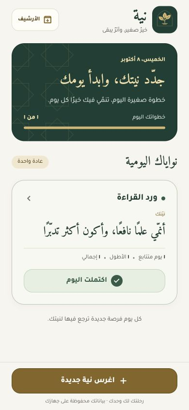

# McKinsey Forward Projects

مجموعة من المشروعات والتطبيقات الشخصية التي أبنيها لتحويل ما أتعلمه في **McKinsey Forward Program** إلى تجارب عملية قابلة للاستخدام والمشاركة.

This repository is a collection of personal projects and practical applications inspired by the concepts and skills I learned through the **McKinsey Forward Program**.

## 01 — نية | Niyyah

**نية (Niyyah)** is my first mobile application in this learning journey. It is an Arabic, offline-first habit builder that helps people connect daily habits with the person they want to become—not only with goals, streaks, or productivity numbers.

The app guides each habit through five connected ideas:

- **Intention:** the quality or direction the person wants to cultivate.
- **Meaning:** why the habit matters personally.
- **Cue:** what triggers the habit.
- **Routine:** the specific action to perform.
- **Reward:** what reinforces the behavior.

**Version 2.0.0** introduces the gold and Islamic geometric visual identity under the name **نية**, with an ivory background, Arabic typography, a sprout icon, and clear daily progress.

**Version 2.1.0** adds optional daily reminders: choose a local time, allow notification permission, and receive a notification with the habit name. Reminders follow time/name changes and pause when a habit is archived or removed.

### Download and source code

- [Download the Android APK](https://github.com/YouseifUS/mckinsey-forward-projects/releases/download/intention-v2.1.0/niyyah-v2.1.0.apk)
- [View the v2.1.0 release notes](https://github.com/YouseifUS/mckinsey-forward-projects/releases/tag/intention-v2.1.0)
- [Browse the complete source code](./projects/intention)
- Version: `2.1.0`
- Built with **React Native + Expo** for Android and iOS. [Run and build the application](./projects/intention#run-locally).
- Android support: Android 7.0 and newer (`arm64-v8a` and `armeabi-v7a`)

> The APK is signed with a testing key and is intended for direct installation and evaluation. It is not a Google Play production build.

## Open-source use | الاستخدام مفتوح المصدر

This repository is released under the [MIT License](./LICENSE). Anyone may use, copy, modify, merge, publish, distribute, sublicense, or sell copies of the project, provided that the copyright notice and license are preserved.

هذا المستودع متاح تحت رخصة MIT، ويحق لأي شخص استخدام المشروع أو نسخه أو تعديله أو تطويره أو توزيعه، مع الاحتفاظ بإشعار حقوق النشر ونص الرخصة.

## Independent project disclaimer | إخلاء المسؤولية

These are independent personal learning projects created through individual effort. They are **not official projects of McKinsey & Company or the McKinsey Forward Program**, and they are not sponsored, endorsed, reviewed, or maintained by McKinsey & Company.

هذه مشروعات تعلم شخصية ومستقلة تم تنفيذها باجتهاد فردي، وليست مشروعات رسمية تابعة لشركة McKinsey & Company أو برنامج McKinsey Forward، ولا تمثل اعتمادًا أو رعاية أو مراجعة من جانبهم.
